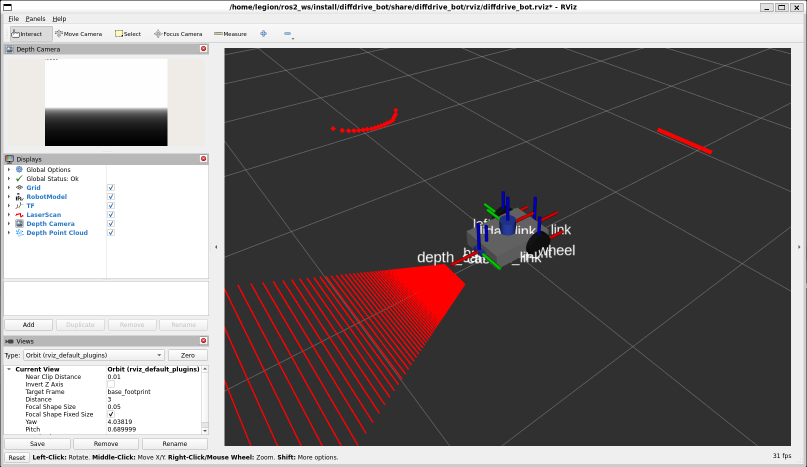
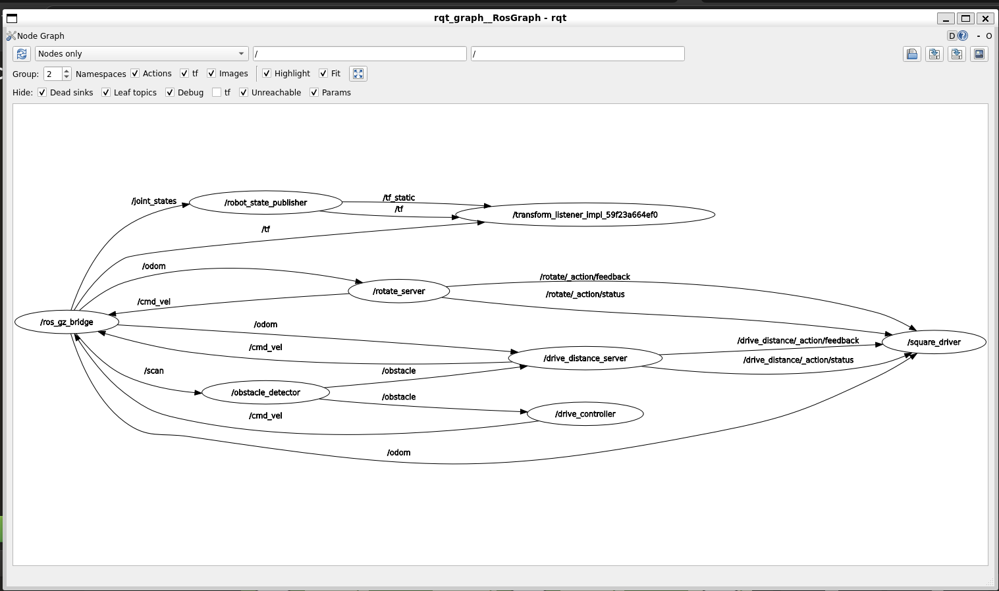

# Lab 1 Exercise: Program diffdrive_bot

**Student:** Yohannes Gumata

**ID:** UGR/4852/16

This standalone ROS 2 workspace source folder completes the seven tasks in Lab 1. It adds a rear
depth camera and an IMU to `diffdrive_bot`, then implements obstacle avoidance, custom interfaces,
services, a rotation action server, and a square-driving action client.

## Packages

| Package | Purpose |
| --- | --- |
| `diffdrive_bot` | Robot description, Gazebo world, bridge, launch files and supplied nodes |
| `lab_interfaces` | Supplied obstacle, speed and drive-distance interfaces |
| `my_robot_interfaces` | `RobotStatus`, `SetTurnSpeed` and `Rotate` interfaces |
| `my_robot_nodes` | `turn_away`, `rotate_server`, `square_driver` and `square.launch.py` |

## Requirements

- Ubuntu 22.04
- ROS 2 Humble Desktop
- Gazebo Harmonic and `ros-humble-ros-gzharmonic`
- `ros-humble-xacro`, `ros-humble-joint-state-publisher-gui` and
  `ros-humble-teleop-twist-keyboard`

See [`diffdrive_bot/README.md`](diffdrive_bot/README.md#what-you-need) for the Gazebo repository and
installation commands.

## Build

Clone this repository into a ROS 2 workspace and build all four packages:

```bash
source /opt/ros/humble/setup.bash
mkdir -p ~/ros2_ws/src
cd ~/ros2_ws/src
git clone https://github.com/Johannes2240/lab1_exercise.git
cd ~/ros2_ws
colcon build --symlink-install --packages-up-to my_robot_nodes
source install/setup.bash
```

Source both setup files in every new terminal:

```bash
source /opt/ros/humble/setup.bash
source ~/ros2_ws/install/setup.bash
```

## Step 1: Depth Camera and IMU

View the model and verify the rear camera transform:

```bash
ros2 launch diffdrive_bot display.launch.py
ros2 run tf2_ros tf2_echo base_link depth_camera_link
```

Run the simulation, then add Image and PointCloud2 displays in RViz for
`/depth_camera/image` and `/depth_camera/points`:

```bash
ros2 launch diffdrive_bot gazebo.launch.py
ros2 topic hz /imu
ros2 topic echo /imu
```

## Steps 2-5: turn_away

Start the robot and the obstacle-avoidance node in separate sourced terminals:

```bash
ros2 launch diffdrive_bot control.launch.py
```

```bash
ros2 run my_robot_nodes turn_away
```

The node starts disabled. Inspect its custom status and update its parameters:

```bash
ros2 interface show my_robot_interfaces/msg/RobotStatus
ros2 topic echo /robot_status
ros2 param set /turn_away forward_speed 0.4
```

Enable it, set a valid turn speed, test rejection of an excessive speed, and stop it:

```bash
ros2 service call /turn_away_enable std_srvs/srv/SetBool "{data: true}"
ros2 service call /set_turn_speed my_robot_interfaces/srv/SetTurnSpeed "{turn_speed: 1.0}"
ros2 service call /set_turn_speed my_robot_interfaces/srv/SetTurnSpeed "{turn_speed: 3.0}"
ros2 service call /turn_away_enable std_srvs/srv/SetBool "{data: false}"
```

Do not enable `/drive_enable` while `turn_away` is driving because both nodes publish to
`/cmd_vel`.

## Step 6: Rotate Action

With `control.launch.py` running, start the action server and send a quarter-turn goal:

```bash
ros2 run my_robot_nodes rotate_server
ros2 action send_goal --feedback /rotate my_robot_interfaces/action/Rotate "{angle: 1.57}"
```

The result and feedback report signed radians turned. A zero-angle goal is rejected and cancellation
immediately publishes a zero velocity.

## Step 7: Square Driver

The launch file starts the simulation, supplied control nodes, rotation server and square client:

```bash
ros2 launch my_robot_nodes square.launch.py side_length:=0.8
```

The client waits for odometry and both action servers, then sends one drive goal and one left
quarter-turn goal for each of four sides. It stops the sequence and reports the side if any goal is
rejected, aborted or canceled.

## Results

### Depth Camera and Point Cloud



### Square Action Graph


